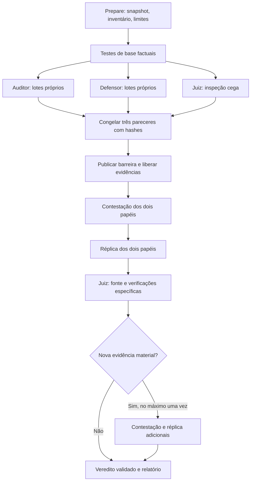

# Arquitetura e contratos

O backend único é Codex App Server 0.167.0 por stdio privado. Python/Pydantic/asyncio
fazem a orquestração determinística e Docker/Compose executa os testes. Não há gerente
modelo. `CodexRuntime` cria três threads novas e separadas, uma por papel, antes do
debate. Ferramentas e configuração nativas são restritas conforme
[contrato Codex Pro](codex-pro.md). Nenhum caminho de geração por API permanece ativo.

Cada papel possui `roles/<papel>/attempts`, `phases`, `initial`, `state` e uma
vinculação `codex-session` com ID explícito. Retomada confere papel, run, backend,
versão, modelo, conta e snapshot. O histórico Codex é próprio de cada papel; os
pareceres de terceiros só entram depois da barreira. Na fase cega não há fork nem
retomada de uma conversa informada. As sessões privadas ficam com o cliente oficial;
não são exportadas. Usar três sessões do mesmo modelo não promete independência
estatística: vieses podem estar correlacionados.

A investigação inicial de Auditor/Defensor particiona todos os arquivos incluídos,
incluindo testes, configuração, migrações e requisitos. Uma fonte grande pode exceder
tempo, turnos ou entrada: a execução termina parcial com intervalos
ausentes. O Juiz escolhe na fase cega entradas críticas, arquitetura e invariantes;
sua inspeção não é declarada como varredura integral. Cada fase de contestação usa
um pacote publicado congelado, evitando que a ordem de execução altere suas entradas.

Pareceres iniciais são imutáveis. `barrier.json` só existe depois dos três pareceres,
e registra hashes e instante de publicação. As ferramentas impedem acesso cruzado a
receipts e narrativas antigas antes disso. Reproduções iniciais não são dados
compartilhados; testes de base são. Relatórios antigos reconhecidos por `prior_reports`
ficam em quarentena separada. Ajuste esses padrões antes de preparar: não há classificador
semântico infalível de narrativas antigas com nomes arbitrários.

Após a revisão do Juiz, uma única rodada adicional é permitida quando há novo achado
fundamentado ou novo receipt. Problemas novos no veredito final ficam como pendentes
para investigação, sem correção obrigatória. Achados tardios de outros papéis devem
ser registrados como limitação para uma nova auditoria, evitando rodadas infinitas.

## Contratos 1.0

Todos usam Pydantic e rejeitam campos extras. `RunManifest` identifica fonte, arquivos,
omissões, requisitos, perfis, configuração e prompts. `InspectionRecord` diferencia
análise registrada e fluxo declarado verificado. `CandidateFinding` preserva mecanismo,
intervalos/hashes, gatilho, condições, proteções, esperado/observado, origem e evidências.
`EvidenceReceipt` é emitido pelo executor, nunca pelo modelo. `AgentPosition` preserva
contestação, mudança de posição e decisão sugerida. `Verdict` tem classificação e
decisão independentes, avaliação de impacto/alcance/custo/regressão/reversibilidade,
interpretação do teste e justificativa de obrigatoriedade.

`positions.finding_id` pode referenciar um achado da própria resposta, depois de
esse achado passar por todas as validações de identidade, fonte, leitura e
evidências. Em `initial-*` e `blind`, só são admitidos esses achados e os anteriores
do próprio papel; achados de terceiros ainda não publicados ao papel são
inacessíveis, independentemente da ordem em que terminem. Nas fases posteriores,
posições também podem referenciar os achados publicados. As restrições existentes
sobre quais fases podem introduzir achados novos continuam aplicáveis. Um ID sem
achado correspondente validado permanece inválido.

Falha comprovada pode usar reprodução executada ou demonstração estática verificável.
Uma hipótese não pode virar “corrigir agora” nem “programar correção”. Risco fundamentado
pode justificar correção se houver justificativa concreta; consenso não é prova.
Um receipt válido prova origem/versão/comando/resultado, não a correção de uma asserção.

O Juiz precisa consultar diretamente os intervalos dos achados e verificar as evidências
citadas. A correção semântica do parecer continua dependendo da análise; o controlador
não tenta transformar validação estrutural em prova matemática de que o modelo entendeu.
O julgamento exige também consulta direta e avaliação explícita dos testes de base
executados, inclusive divergências de expectativas. Leituras internas de validação
de procedência não contam como evidência consultada pelo modelo.

Deduplicação agrupa somente decisões com a mesma causa-raiz e mecanismo demonstrado.
IDs originais, posições e receipts são preservados. A contagem de IDs candidatos é
separada da de achados após deduplicação e causas-raiz estabelecidas. Suites, casos,
asserções e asserções falhas ficam desconhecidos quando o processo não fornece
contagens confiáveis. Não se usa `exit 0` como medida de cobertura.

## Cobertura e conclusão

`coverage.json` registra, por papel/arquivo, intervalos efetivamente devolvidos,
intervalos com análise registrada e intervalos com fluxo declarado verificado.
Truncamentos e linhas grandes omitidas ficam explícitos. Listar arquivos não conta
como leitura; ler não conta como análise. Testes executados são contados separadamente
pelos receipts. Não se infere cobertura de código executado sem instrumentação própria.

Estados operacionais: prepared, running, completed, partial, failed, cancelled.
Na avaliação `scoped-assessment-2`, `completed` significa conclusão do escopo,
inclusive quando há defeitos comprovados. `completion_assessment` separa bloqueios
estruturados (cobertura, fases pendentes, julgamento ausente e achados sem
contraditório) das notas. Todas as mensagens, inclusive limitações internas de
inspeções/achados, são preservadas com suas origens. Mensagens não classificadas
continuam bloqueantes. Uma revisão explícita do controlador, vinculada ao hash do
contexto e ao objetivo, pode justificar `scope_note` ou `procedure_note` com
referências às evidências; não há descarte por palavras-chave. Essa revisão nunca
suprime uma lacuna estruturada ou uma fase obrigatória ainda pendente.

Agrupamentos causais não dependem de igualdade textual, localização ou rótulo do
Juiz. Certificados separados do controlador identificam versão da fonte, função,
operação AST, precondição e intervenção, vinculados ao hash de cada achado. O
verificador atual suporta funções Python puras de uma expressão numérica, sem
executar fonte ou scripts: confere asserções e observações dos receipts íntegros,
preservação de controles e diversidade de casos. Um grupo exige certificados
equivalentes para todos os membros; operações distintas permanecem distintas,
mesmo no mesmo intervalo e com descrições iguais. Provas ausentes ou fora desse
subconjunto permanecem lacunas, sem fusão automática. Essa prova é limitada à
operação e aos casos observados, sem promessa de correção universal.

`verdicts` continua contendo exatamente uma decisão por ID. A aceitação conta
`proven_causal_groups` verificados e mantém todas as exigências de participação,
inspeção e controle. Reprocessamentos usam Store somente leitura, selecionam uma
única resposta original por vez e geram relatórios derivados com versão, hashes
do código e critérios; não alteram o run nem representam nova execução real.
Resultado técnico é separado. “Nenhuma alteração necessária no escopo verificado” é
permitido quando as decisões não exigem alterações, acompanhado das limitações.
Cobertura incompleta não vira aprovação integral. Um resultado mock nunca recebe
o rótulo de auditoria real. Não há “código perfeito”, “segurança garantida” nem
homologação em produção.
